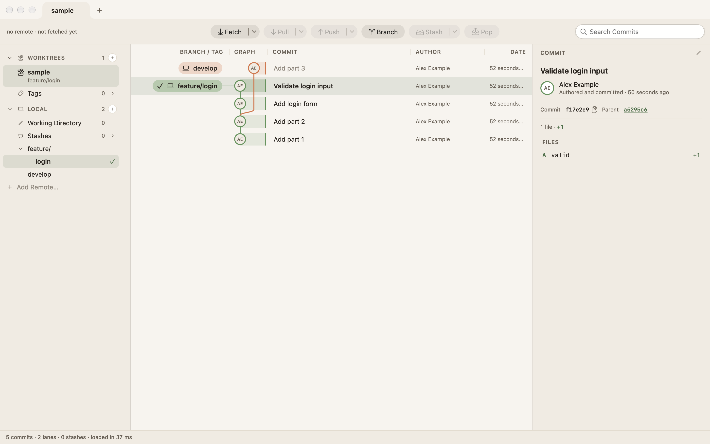
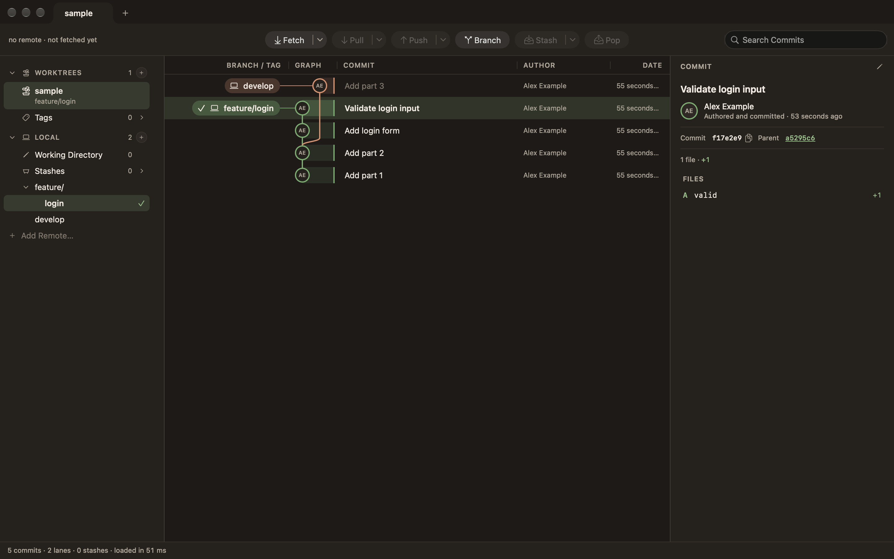

# GitBonsai

GitBonsai is a native macOS Git client built around the commit graph. It shows the whole history of a repository as one fast graph, puts branches, worktrees, tags and stashes side by side in a clear sidebar, and turns the things that usually need a sequence of git commands — rebasing a branch whose base moved, checking out with your changes carried along, cleaning up branches everywhere — into one action you can undo. It runs the `git` already installed on your Mac; nothing is reimplemented and nothing leaves your machine.

## Principles

- **Native.** A Mac app in AppKit, with the Mac's keyboard handling, menus, light and dark appearance and Liquid Glass.
- **Plain git.** Every read and write is a run of the `git` command line tool you already have. Your configuration, hooks and credentials apply as they do in a terminal.
- **No AI, no cloud, no account.** GitBonsai talks to your remotes and, if you allow it, to GitHub, GitLab or Gravatar for author pictures. Nothing else.
- **You see what it runs.** The status line names the git command of the last action, how long it took or why it failed; a failure opens git's own output on request.
- **Worktrees are first class.** Every worktree of a repository is in the sidebar, one click away.
- **Fast on large histories.** The history streams in as git delivers it and is laid out in one pass; a repository with 100,000 commits shows its first rows almost at once.
- **Local actions just run, and can be undone.** Checkout, reset, merge, rebase, cherry-pick, revert, amend, dropping commits, deleting a local branch or tag and removing a remote run without asking and offer Undo in the status line as long as nothing moved since. Actions that lose work or touch a remote ask first.

## Features

### History and graph

- One graph for the whole history: branches, merges and stashes in lanes, laid out in a single pass — 100,000 commits in about a tenth of a second.
- A graph wider than its column scrolls sideways, and author pictures of lanes out of view stay pinned at its edges.
- Three history orders: by commit date, by author date, or branches kept together. Choose it in the column header or in Settings.
- **Go to Ref…** (⇧⌘O) jumps to any branch, remote branch, tag, worktree or stash; ⌥⏎ checks it out.
- **Go to parent or child** with ⌘↓ and ⌘↑; a picker opens when there are several.
- **Search commits** (⌘F) by subject, body, author, co-author, ref name or SHA prefix, and step from match to match.
- Select several commits with ⌘- or ⇧-click to compare them: two commits directly or from their merge base, a run of commits as one combined change. The detail panel shows the git command behind the comparison.

### Index and working tree

- Staged and unstaged changes in separate lists, with the working directory as the first row of the history.
- Stage, unstage or discard single files, several selected files, single hunks or everything; discarding moves untracked files to the Trash. "Discard all" in the working directory's title takes back staged and unstaged changes, and can move untracked files to the Trash. Several selected files show their diffs one below the other.
- A commit form with subject and body, amend and sign-off. **Commit** ⌘⏎, **Commit all** (stages everything first) ⇧⌘⏎, **Amend** ⌥⌘⏎.
- Stash ⇧⌘S and pop ⌥⇧⌘S, with Undo right after stashing.

### Diff

- Diff or whole file, remembered across files.
- Word diff, ignore whitespace, ignore changes in whitespace amount, ignore blank lines, and invisible characters (tabs, trailing spaces, CR, BOM, non-breaking spaces).
- Image diff side by side, as a swipe or as an onion skin, for PNG, JPEG, GIF, WebP, HEIC, TIFF, SVG, PDF and more.
- Open a file in your diff tool, editor or default app.

### Sidebar

The sidebar is ordered by how often you need things:

- **Worktrees** — every worktree with its branch and how many changes it has; click shows its HEAD in the history, double-click switches to it. The + creates a new worktree.
- **Tags** and **Stashes** — lists in a popover with a filter, to jump to, check out, push, apply, pop or drop; tags switch between all, local only, remote only and diverging. A stash shows its staged and unstaged changes, untracked files included.
- **Local** — your branches with ahead/behind counts, grouped into folders by their prefix (`feature/`, `fix/`, …). A branch checked out in another worktree is marked. Click shows the branch, double-click checks it out. The + creates a branch.
- **One section per remote** — its branches, likewise in folders, plus **Add Remote…**.

Every row has a context menu with what it offers: fast-forward, checkout, merge, rebase, pull, push, rename, upstream, create worktree, delete, edit or remove a remote, lock or remove a worktree, and more.

### Branches, remotes and tags

- Fetch all remotes ⇧⌘F, one remote, with pruning, or tags only; optional automatic fetching every time the app becomes active (switching back within a few seconds does not fetch again) and periodically, less often on battery and never in Low Power Mode.
- Pull ⇧⌘L as configured, fast-forward only, merge or rebase; pull a branch that is not checked out.
- Push ⇧⌘U, push and set the upstream — also for a branch that is not checked out, from its menu — push tags. A rejected push offers to pull and push again or to overwrite with `--force-with-lease`.
- Fast-forward any local branch to its upstream or to HEAD without checking it out.
- **Delete Branches…** removes a branch everywhere at once, locally and on its remotes, and shows whether its commits exist anywhere else.
- Add, edit and remove remotes.
- Create lightweight or annotated tags, push, fetch and delete them locally or on a remote; the menus offer per remote only what applies, and replace a differing tag after asking.

### Rebase, history editing and conflicts

- **Interactive rebase** in a sheet: reorder by drag or ⌥↑/⌥↓, pick, reword, edit, squash, fixup or drop with a single key, and watch the result in a live preview. Optionally move dependent branches along (`--update-refs`) and stash local changes for the rebase.
- **Rebase onto a commit with a detected base.** For a branch whose base was rewritten or merged, GitBonsai finds where its own commits start — the tip of the branch it was stacked on, commits that already arrived squashed upstream, or the fork point of a rewritten upstream — and rebases only those with `git rebase --onto`. When the base is ambiguous it falls back to a plain rebase; a toast names the commits it left out, and the interactive sheet shows every choice.
- **Edit Commit Message** (⌘E) in place, **Squash Commits…**, **Move up/down**, **Drop Commit…**, reset (soft, mixed, hard), cherry-pick onto the current branch and revert from the commit menu.
- A banner for a running rebase, merge, cherry-pick or revert with its step, its conflicts and Continue, Skip, Abort or Amend Commit. Meanwhile menu entries that would move HEAD or rewrite history stay disabled and say why.
- A **conflict view** that steps through changes (⌥⌘↑/⌥⌘↓), merges simple conflicts by itself, resolves the remaining ones as ours, theirs or both in either order, shows the base, and marks files resolved — or a **merge window** to resolve side by side, or your own merge tool.
- Conflicted files in the file list, one or several at once, and all of them from the banner's "Resolve all": accept the version of a branch by its name, keep or delete a file one side deleted, mark as resolved or bring the conflict markers back, compare against the base or either side, and list the commits behind the conflict.
- **Undo** in the status line for checkout, reset, merge, rebase, cherry-pick, revert, amend, branch and tag deletion, removing a remote and interactive rebases.

### Worktrees

- Create a worktree from the sidebar, from a branch, or from any commit, with a new branch if you like.
- Switching to another worktree keeps the tab and only changes what it shows, so it is instant; a tab that already shows that worktree comes to the front.
- The sidebar shows at a glance which branch is checked out where, and checking out such a branch switches to its worktree instead.
- Lock, unlock and remove worktrees, removing their branch along with them if you want; a worktree whose folder is gone is removed from its own menu.

### Command bar and keyboard

- The **command bar** (⇧⌘P) runs every command of the menus and the context menus by name.
- Tabs for several repositories (⌘T, ⌘W, ⇧⌘] and ⇧⌘[), Reopen closed tab ⇧⌘T, Open Repository ⌘O, Clone ⌥⌘N, New Branch ⌘B, Open in Terminal ⌥⌘T, Open in Editor ⇧⌘E, Show in Finder ⇧⌘R.
- Shortcuts follow your keyboard layout.

### Settings

- **General:** appearance, history order, language, and the folders whose repositories a new tab suggests.
- **Apps:** your editors and terminals, the default one, and which appear in the "Open with" choices.
- **Git:** which git binary to use, the merge tool, and automatic fetching.
- **Avatars:** initials only, pictures from the remote host (GitHub, GitLab), or also Gravatar.

## Quality of life

Things that usually take several git commands, done in one step:

- **Checkout carries your changes.** Switching branches stashes uncommitted work, switches and brings it back; if it conflicts, the stash stays and the app says so.
- **Checkout and fast-forward** a branch to its upstream in one go, or for a branch that diverged choose between resetting to the upstream and just checking out, with the number of commits that would be lost.
- **Checkout a remote branch** creates the tracking local branch.
- **Rebase an outdated branch** onto main after its base was merged or rewritten, without replaying commits that are already there.
- **Stash and try again** when local changes block an action.
- **Pull a branch you are not on**, and for a diverged one offer to check it out and pull, reset it to its upstream, or switch to the worktree that has it.
- **Delete a branch everywhere** — locally and on every remote — from one sheet.
- **Undo** the last checkout, reset, merge or rebase from the status line.

## Install

Download the DMG from the [latest release](https://github.com/daberni/gitbonsai/releases/latest), open it and drag GitBonsai into Applications. GitBonsai needs macOS 26 and git 2.38 or later.

Builds that are not notarized are signed ad hoc. macOS then refuses the first launch: open **System Settings › Privacy & Security** and choose **Open Anyway** for GitBonsai once.

## License

GitBonsai is free for personal and other noncommercial use under the [PolyForm Noncommercial License 1.0.0](LICENSE). Use for work at or for a company needs a commercial license; see [COMMERCIAL.md](COMMERCIAL.md).

GitBonsai uses the `git` installed on your Mac as an external program; it does not bundle git or any other third-party code.

## Development

Building, testing, benchmarks, profiling and releases are described in [docs/development.md](docs/development.md).
