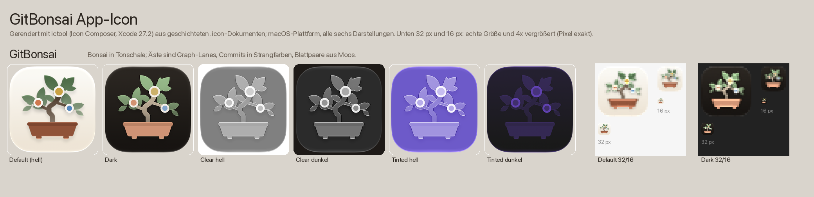

# App icon

A bonsai in a clay bowl whose branches are history lanes: the trunk bends in the same S-curves as the graph, and each branch ends in a commit in a strand colour. Pairs of moss leaves sprout along the branches and behind each commit.

## Files

- `AppIcon.icon` — the Icon Composer document (macOS 26, layered for Liquid Glass). Icon Composer opens it; `scripts/make-app-bundle.sh` compiles it with `actool`.
- `AppIcon.icon/Assets/*.svg` — one SVG per layer, `-dark` for the dark appearance, on a 1024 pt canvas.
- `make-icon.py` — writes the document from the shapes and the token colours. Change shapes or colours there and rerun it; fine-tuning in Icon Composer afterwards is fine, but a rerun overwrites it.
- `preview.png` — rendered with Icon Composer's `ictool` in Default, Dark, Clear light/dark and Tinted light/dark; `icon-services.png` — the built bundle's icon as Icon Services draws it at Dock, Finder, Spotlight and list sizes.

## Layers

Front to back, as Icon Composer stores them:

| Layer | Content | Translucency |
| --- | --- | --- |
| commits | three commit dots with a paper ring | off: nothing shows through |
| bowl | clay bowl with rim and feet; the trunk ends flat at the rim | off |
| trunk | bark trunk and two branches, drawn as graph lanes | 0.4 |
| leaves | nine moss leaf pairs | 0.5 |

The background is a vertical gradient of paper. All groups are glass with specular highlight and a neutral shadow; the system derives Clear and Tinted from them.

## Colours

| Part | Light | Dark |
| --- | --- | --- |
| Background | `#fbf8f3` → `#efe4d4` (surface-0 into deeper paper) | `#2c2621` → `#191512` (bark) |
| Leaves | `moss` | `moss` |
| Bowl | `clay`, rim `#86432a` | `clay`, rim `#c47f60` |
| Trunk | bark `#5b4433` | bark `#c9b49c` |
| Commits | `strand-persimmon`, `strand-ochre`, `strand-sky` | same tokens, dark values |
| Commit ring | `surface-0` | `ink` |

Token values come from `../tokens.json`; the shades without a token are named in `make-icon.py`.

## How it came about

Three first concepts were drawn: A, a bonsai whose branches are graph lanes; B, a single branching trunk with filled commits; C, an abstract bowl with a sprout meeting in a commit. C was dropped because it shows no branching, and B in a bowl read more like a cactus than a bonsai. A got C's leaf pairs and B's filled commits; the fanned-leaf version was chosen and then got more leaf pairs, a bowl that hides the trunk and opaque commits, which is `AppIcon.icon`.
