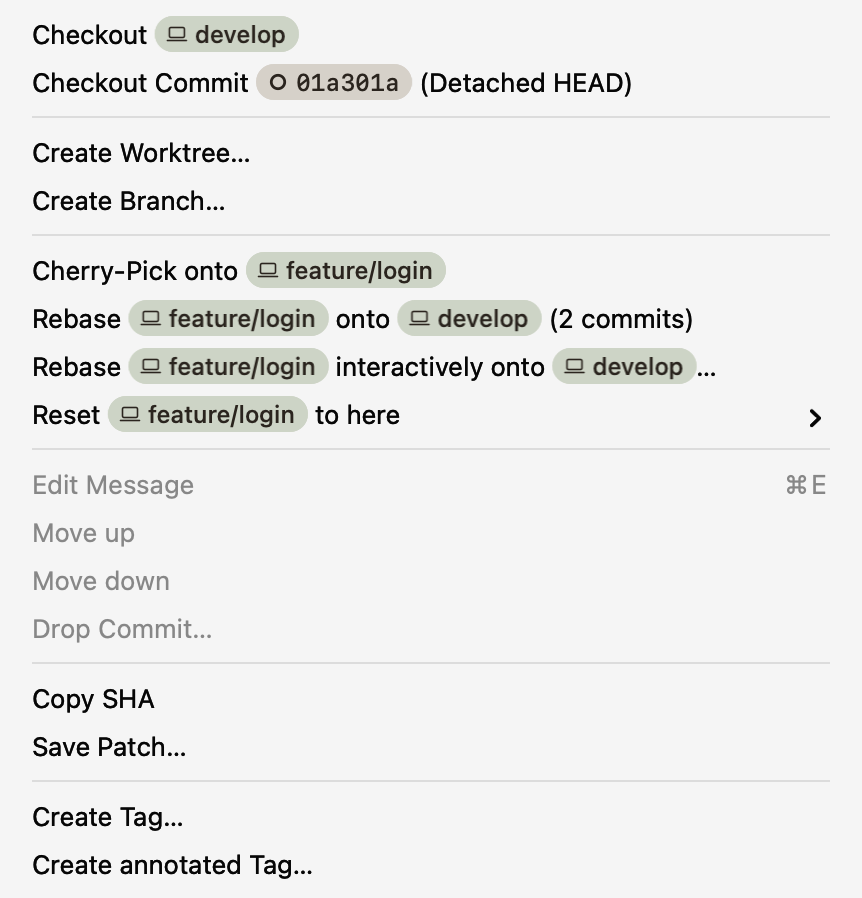
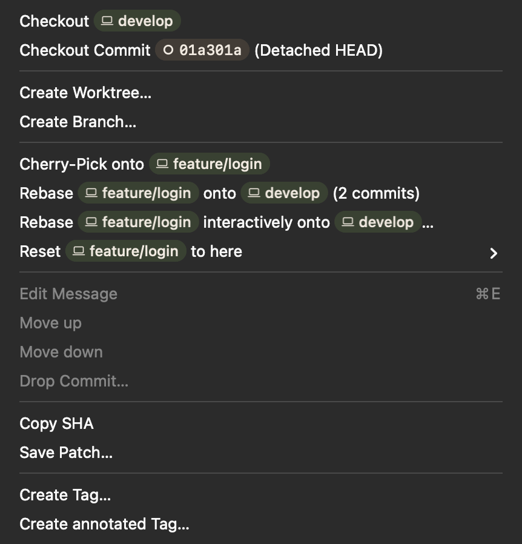
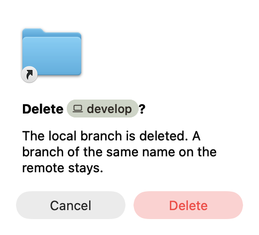
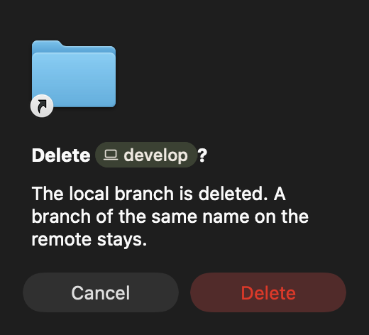

# Ref names in running text: design study

The study was made while the interface was still German only; its examples are given in English here.

Decision: D2 without the highlight swap: inline mini pills with a hidden plain copy of each name, implemented in `RefText.swift` and `RefText+Alert.swift` and described in `design-language.md` (Lines and graph). The study's harness switch and overview script were removed with the implementation; the captures below stay as the record. The study's per-variant captures were removed; the final result is kept in `ref-text-shots/final/` (see the end of this page).

## Inventory

Commits and SHAs follow the same style as refs (`\(commit: id)`). About 110 interpolations with German quotes „…“ in 26 files of `Sources/GitBonsai`, plus about 30 with bare SHAs or names (for example `Checkout Commit \(id.prefix(7))`, `Create Branch at 1a2b3c4`, the toolbar's upstream text, `RebaseUndoController`).

- Menus (≈45): `BranchActions`, `CheckoutUseCase`, `CommitActions`, `RebaseOntoUseCase`, `PullUseCase`, `PushUseCase`, `FetchUseCase`, `TagActions`, `FileActions`, `WorktreeActions`.
- Sheet titles and messages (≈45): the same controllers plus `SidebarActionsController`, `StagingUseCase`, `StashActions`, `InteractiveRebaseUseCase`/`Sheet`, `RebaseUndoController`. Most go through `NSAlert` (`ActionForm`, `ActionRunner.confirm`).
- Banner: `OperationBanner.describe` (inconsistent at the time: "from „x“ onto y").
- Tooltips and tag status: `TagRows`, `RemoteTagCache`, `RebaseUndoController`.
- Field messages: `NewBranchViewController`, `RebaseBasePicker`, `GitSettingsViewController`.
- Status line: shows git command lines, not prose; refs there stay verbatim.

## What NSMenu renders (macOS 26, real `NSMenu.popUp`, highlight through the private `highlightItem:`)

- `.font` (monospace) works. Highlighted rows turn text white, so B and E stay readable.
- `.backgroundColor` works (C1) but is a hard rectangle without padding or radius; it stays visible on the blue highlight.
- `NSTextAttachment` images work (C2, D) and keep their own colours when highlighted: tinted pills on the accent blue. Template images (E's glyphs) are tinted with the highlighted text.
- Attachments turn into U+FFFC in `item.title`: type-select and the harness's title matching break ("Rebase  onto "). `setAccessibilityLabel` on the item takes the plain text, so VoiceOver can be fixed; type-select and `choose(...)` in the harness would need the plain title stored elsewhere.
- Menus never truncate; the formatter cuts names longer than 220 pt in the middle (`feature/PROJ-1…h-cost-centres`) in all variants but A.
- Custom `NSMenuItem.view` was not prototyped: it loses native highlight, keyboard navigation, type-select, submenu arrows and accessibility, each of which would have to be rebuilt per item. Not recommended.
- `NSAlert` takes only plain strings; attributed text in sheets needs `ActionForm`/`confirm` moved to an own sheet or an accessory view.

## Variants

- A: quotes (today).
- B: monospace, same weight, no quotes. Native, cheapest, survives highlight; reads as code.
- C1: monospace with `.backgroundColor`. Native but square and tight; not recommended.
- C2: monospace on a rounded neutral tint, as an image. Looks like inline code; title loses the name for type-select.
- D: mini pill with glyph in the kind's colour (moss local, sky remote, ochre tag, muted commit). Closest to the history; strongest visual noise in long menus, colour on the blue highlight, and on the clay banner the tints compete.
- D2: D with two workarounds. (1) Before each pill the name goes in once more as text at 0.01 pt in a clear colour, so the plain title reads "Checkout develop": type-select by the first letter, the harness's title matching and VoiceOver's fallback get the name; `setAccessibilityLabel(plain)` gives VoiceOver the clean sentence. (2) An `NSMenuDelegate` swaps the row's title in `menu(_:willHighlight:)` to pills drawn white on a 22 % white ground, and back when the highlight moves on. Captured with the delegate firing for the highlighted row; not yet checked with VoiceOver running or with live typing.
- E: semibold name with a muted template glyph. Native text, glyph tints with the highlight.
- F: E's glyph and C2's look as text: template glyph plus monospace name, both on `.backgroundColor`, padded with hair spaces. The name stays real text (title "Rebase  feature/login onto  develop"); the tint is a square rectangle, since menus draw the attribute without radius.
- F2: F with tint and glyph in the kind's colour (moss local, sky remote, ochre tag, muted commit). `.backgroundColor` takes any colour, also dynamic per appearance; the tint is the colour at 18 %. A coloured glyph cannot be a template image, so it keeps its colour on the highlighted row (low contrast in light: moss on blue). Template glyphs (E, F) are always tinted by the menu with the text colour; a muted `.foregroundColor` on the attachment is ignored.
- Glyphs as attachments (E, F) still put U+FFFC into the title: an entry that starts with a ref (" develop …") is no longer reached by typing its first letter. F without the glyph keeps the title fully clean.

## Recommendation

Update after D2: D2 looks like D and fixes its title and highlight; it is the recommendation if the workarounds hold up in a VoiceOver and type-select check. Cost on top of F: every menu with names needs the highlight delegate (one shared object set by the menu builders), and sheets still need `ActionForm`/`confirm` to draw their own text.

Earlier recommendation:

B for menus and sheets, optionally with E's glyph for refs only (not commits or paths). It keeps the native menu behaviour (type-select, VoiceOver, highlight) and needs no change to `NSAlert`. D is only worth it in our own views (banner, toasts), not in menus.

## Cost of a shared `RefText`

One formatter (`RefString` + `RefText.render`) and every call site rewritten to interpolation: ≈140 strings. Menus: `ActionMenuItem` takes a `RefString` and sets `attributedTitle` (B/E: plain title stays readable). Sheets: B/E work only after `ActionForm`/`confirm` render their texts themselves instead of `NSAlert`; C2/D additionally need the plain title kept for type-select and the harness.

## Result

A commit menu and a confirmation from the app, light and dark, on a sample repository:

 
 
